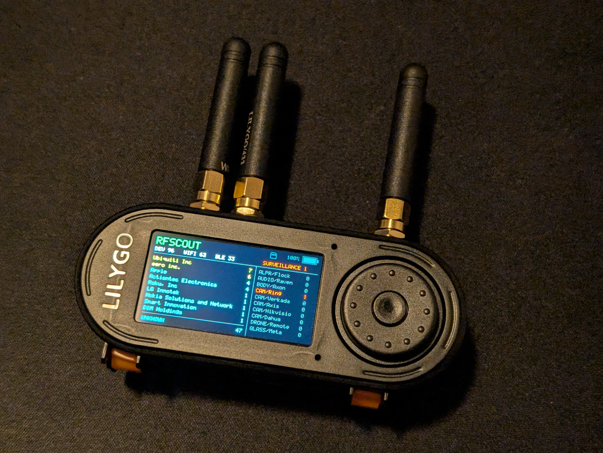

# RFScout

RFScout is a handheld **RF situational-awareness** instrument for ESP32-S3. The currently supported hardware profile is the **LILYGO T-Embed CC1101 Plus**. RFScout retains a runtime board-profile and capability abstraction so future hardware can be added without exposing board identity to applications.

RFScout combines passive Wi-Fi/BLE observation, board-appropriate RF capabilities, SD logging/storage, semantic input and notifications, persistent device configuration, battery telemetry, and optional hardware-specific applications exposed only when the active runtime profile has a safe provider.

<p align="center">
  
</p>

RFScout is intentionally passive wherever the underlying radio APIs allow it. It is designed to answer “what electronic activity is around me?” without requiring continuous raw-packet inspection.

## Applications

Top-level application order is:

0. **System Events** — optional and disabled by default
1. **Home / Device Settings**
2. **WiFi / BT**
3. **CC1101** — only when the active board provides the current CC1101 service
5. **nRF24** — only when the active board provides the current nRF24 service
6. **Recorder** — only when the current audio-capture/storage providers are available
7. **Thermal** — only when enabled and an MLX90640 is detected
8. **Audio Spectrum** — when enabled and the microphone provider is available

Disabled or unavailable apps are skipped. Home is always available and is the default/fallback startup target. Applications consume board-neutral semantic input, service availability, and a managed application view rather than board names or physical controls.

### Firmware Update

Firmware Update is a nested Home / Device Settings menu rather than a top-level application. Opening **Update** starts only a passive infrastructure-Wi-Fi scan; it never associates automatically. The menu owns a bounded list of remembered SSIDs/passwords in its own persistent namespace, shows remembered APs that are currently visible, provides explicit per-network Connect/Disconnect/Forget actions, and clears transient STA state when the Update menu closes or Home exits. ESP-IDF Wi-Fi configuration is kept in RAM so the driver does not become a second global credential store. The firmware has a platform-owned running-image identity and a bounded OTA build-catalog selector that enforces project/hardware/IDF/layout sanity checks. After explicit association, the menu exposes **Check for update** and **Available builds** actions. Catalog retrieval runs as a cancellable HTTPS service using ESP-IDF certificate-bundle validation; leaving Update cancels acquisition before installer/STA teardown.

### WiFi / BT

WiFi / BT passively observes Wi-Fi/BLE traffic, tracks recent devices in growable app-session PSRAM, performs longest-prefix IEEE vendor attribution, distinguishes private/random addresses from unresolved public addresses, and combines multiple signals for conservative surveillance-oriented classification.

Wi-Fi, BLE, and retained surveillance history currently have independent 10–300 second retention controls. Ordinary Wi-Fi/BLE discovery feedback can be enabled independently; surveillance categories use app-owned notifications.

### CC1101

CC1101 performs receive-only RSSI spectrum sweeps with configurable profiles/range/step, a live activity histogram, conservative RF-behavior classifications, notifications, and count reset.

### nRF24

nRF24 performs receive-only 2.4 GHz RPD scanning with configurable channel bounds/dwell, activity history, conservative classification, and surfaces for validated Enhanced ShockBurst observations. The current RPD scanner does not itself decode packets; no ACK generation, replay, injection, or active discovery is performed.

### Recorder

Recorder uses the board-neutral audio-capture service plus SD storage for 16-bit mono WAV capture and playback. The current T-Embed profile uses its PDM microphone provider while the audio-capture service owns provider selection, hardware probing, transport lifecycle, and reads. Recorder never receives a raw I2S handle. Active recording or finalization blocks app transitions until the file is safely complete.

### Audio Spectrum

Audio Spectrum is the separate live microphone FFT/spectrum app and does not require an SD card. It is exposed only when the active profile has a compatible audio-capture provider. Live frequency labels use measured PCM throughput once available rather than assuming the configured request rate.

### Thermal

Thermal uses an optional MLX90640 on the external I2C/Qwiic interface. Native 32x24 data is interpolated for the LCD; literal thermal imagery bypasses semantic theme color translation.

## Home / Device Settings

Current global settings include brightness/display idle, visual theme, independent **Normal / Quiet** audio policy, UI/Event/Alert presentation levels, supported power-button/protective actions, time source/timezone/manual time, startup/app enablement, SD logging, and breadcrumb policy.

Setting changes are persisted automatically through RFScout's internal persistent-record service; there is no user-facing Save step. App-owned notification settings and WiFi / BT retention remain in their respective app menus.

The Time submenu separates source policy from timezone presentation. **Auto** accepts valid GPS UTC time when the GPS service is available and locked; **Manual** exposes explicit date/time fields. Consumers can distinguish invalid, retained, manual, and GPS-synchronized wall-clock state.

## Power, display, and persistence

Display and power actions are capability-gated by the selected runtime profile. T-Embed retains its validated dedicated power-button, deep-sleep, and physical power-off semantics. The device-wide input lock suppresses semantic navigation/select input but intentionally does not disable T-Embed's dedicated power button.


Persistent preferences are firmware-managed internal records split between device-wide system records and descriptor-owned app records. Time policy is a separate system-owned bounded record. SD is reserved for removable/bulk data and logging, not configuration authority. See `docs/CONFIGURATION.md`.


## Hardware and memory

The runtime board profile owns physical pin mappings, buses, display transforms, capabilities, and power semantics. Provider code initializes only when the selected profile permits it. Unknown hardware remains awake and inert without initializing board GPIO/peripherals so it can be recovered by reflashing.

RFScout requires usable external **PSRAM**. Large app-owned collections can grow dynamically during an app resource session and are reclaimed only after the platform proves workers/callbacks no longer reference them. Internal SRAM remains reserved for system, stack, DMA/hardware-constrained, and latency-sensitive allocations.

See [Board targets and porting](docs/BOARD_PORTING.md).

## Build and flashing

RFScout targets ESP32-S3 with **ESP-IDF 6.1** and enforces clang-format 18.

```sh
idf.py set-target esp32s3
idf.py build
idf.py flash monitor
```

The firmware validates the T-Embed CC1101 Plus runtime profile at startup and leaves unsupported hardware inert. Ready-for-review pull requests can produce short-lived candidate bundles. Published releases are prepared deliberately through the release workflow. GitHub Pages is generated from release and candidate artifacts and carries both the browser flasher and the unified in-device OTA build catalog/application images.

## Documentation

The documentation is intentionally consolidated. Production pages describe current behavior; future design and release planning belong only in the roadmap.

- [Capabilities](docs/CAPABILITIES.md) — implemented user-visible behavior
- [Architecture](docs/ARCHITECTURE.md) — app/service boundaries, lifecycle, resource sessions, UI/audio/power/storage architecture
- [Device configuration and persistence](docs/CONFIGURATION.md) — schema, migration, display/power behavior, SD/logging, time
- [Board targets and porting](docs/BOARD_PORTING.md) — board/capability/memory contract
- [Prefix identity](docs/PREFIX_IDENTITY.md) — generated OUI/prefix and surveillance identity data
- [Coding style](docs/CODING_STYLE.md) — source/style requirements
- [Getting started](docs/GETTING_STARTED.md) — development setup
- [Firmware releases](docs/RELEASING.md) — candidate/release/browser-flasher workflow
- [Roadmap](docs/ROADMAP.md) — canonical completed-work and future-release planning

## License

MIT
