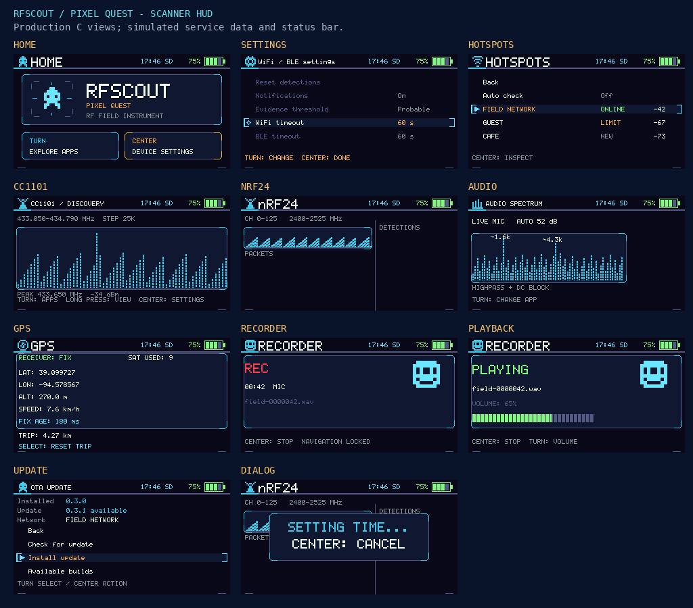

# RFScout

RFScout is a handheld **RF situational-awareness** instrument for ESP32-S3. The currently supported hardware profile is the **LILYGO T-Embed CC1101 Plus**. RFScout keeps board identity behind runtime profile/capability boundaries so applications consume semantic services rather than hardware-specific GPIO or peripheral details.

RFScout combines passive Wi-Fi observation and configurable passive/active BLE discovery, hotspot connectivity checks with durable history, receive-only RF activity monitoring, SD-backed audio recording and logging, thermal imaging with an optional MLX90640, semantic input/notifications, persistent device configuration, battery telemetry, and A/B firmware update support.

<p align="center">
  
</p>

RFScout passively observes Wi-Fi and does not join networks outside Hotspots or Home-managed infrastructure connections. BLE discovery can be configured as active, in which case the controller transmits scan requests; passive BLE discovery does not. Hotspots deliberately joins eligible open and saved-password networks only while active. It is designed to answer “what electronic activity is around me?” without requiring continuous raw-packet inspection.

## Documentation map

This README is the main anchor for **what RFScout contains today**. Detailed current behavior is split only where a focused page is useful; future design and priorities belong in the roadmap.

| Area | Document | Purpose |
| --- | --- | --- |
| Product | **README.md** | Current supported hardware, applications, major behavior, and navigation to the rest of the documentation |
| Development | [Contributing](CONTRIBUTING.md) | Development environment, build/flash workflow, and contributor ramp-up |
| Platform | [Platform architecture](docs/ARCHITECTURE.md) | Board/profile model, app lifecycle, services, memory, persistence, UI/input, power, storage, and OTA invariants |
| Applications | [Home](docs/apps/HOME.md), [System Events](docs/apps/SYSTEM_EVENTS.md), [WiFi / BLE](docs/apps/WIFI_BLE.md), [Hotspots](docs/apps/HOTSPOTS.md), [CC1101](docs/apps/CC1101.md), [nRF24](docs/apps/NRF24.md), [Recorder](docs/apps/RECORDER.md), [Audio Spectrum](docs/apps/AUDIO_SPECTRUM.md), [Thermal](docs/apps/THERMAL.md), [GPS](docs/apps/GPS.md), [Wardriving](docs/apps/Wardriving.md) | Implemented application behavior, controls, data interpretation, dependencies, lifecycle, and current limitations |
| Hardware | [T-Embed CC1101 Plus](docs/hardware/T_EMBED_CC1101_PLUS.md) | Supported board identity, wiring, optional peripherals, and hardware limitations |
| Validation | [Release acceptance](docs/RELEASE_VALIDATION.md) | Repeatable hardware acceptance checklist for implemented features |
| Planning | [Roadmap](docs/ROADMAP.md) | **Authoritative future planning**, active release scope, unfinished work, and brainstorming |
| Operations | [Firmware releases](docs/operations/RELEASING.md) | Candidate, release, browser-flasher, OTA-catalog, and publication runbook |

The boundary is intentional: **README/app/architecture pages describe current implementation; ROADMAP describes intended work.** Git history and pull requests remain the implementation history.

## Applications

Top-level application order is:

1. **System Events** — optional and disabled by default; bounded read-only system-event history
2. **Home / Device Settings** — always available; device policy, networking, firmware update, and global settings
3. **WiFi / BT** — passive Wi-Fi observation and configurable passive/active BLE discovery; the monitor UI already presents itself as **WiFi / BLE**, while some current descriptor/settings labels retain the older name
4. **Hotspots** — joins eligible open, OWE and saved WPA2/WPA3 access points to check NTP and verified HTTPS connectivity, and keeps a grouped SD history with optional GPS locations
5. **CC1101** — receive-only sub-GHz RSSI sweeps and conservative signal-shape classification
6. **nRF24** — receive-only 2.4 GHz RPD activity scanning plus surfaces for separately validated Enhanced ShockBurst observations
7. **Recorder** — SD-backed 16-bit mono WAV recording, post-processing, browsing, deletion, and playback
8. **Thermal** — optional MLX90640 relative-IR heat-map application
9. **Audio Spectrum** — live microphone spectrum/FFT application without an SD dependency
10. **GPS** — live GPS diagnostics and trip-odometer controls
11. **Wardriving** — mixed Wi-Fi/BLE PCAPNG recording with configurable channel and source policies

Disabled or unavailable apps are skipped. Home is always available and is the default/fallback startup target. Applications receive a managed view, semantic input, and platform-owned services rather than board-specific handles.

See the linked app pages in the [documentation map](#documentation-map) for detailed current behavior.

## Pixel Quest visual theme

RFScout includes **Pixel Quest**, an original 8-bit console-inspired theme across every application,
nested settings view, and shared popup. It combines a navy/cyan/amber palette, pixel app icons,
clipped-corner instrument panels, compact selection tabs, segmented graphs, and battery/volume energy cells.
Home becomes a pixel scanner console with the original Scout in a targeting reticle and two command panels for the actual rotary/center controls.

Fresh/default configurations use Pixel Quest. Existing saved Indoor, Outdoor, and Night preferences
remain intact; select **Home → Device Settings → Theme → Pixel Quest** to enable it after an upgrade.
Visual themes remain independent from audio policy. Scientific values, thermal image colors,
application order, input semantics, and acquisition behavior keep their existing meaning.



See [Architecture](docs/ARCHITECTURE.md#visual-presentation) for shared presentation contracts and
[Contributing](CONTRIBUTING.md#host-ui-previews) for reproducible host rendering.

## Platform overview

The current supported runtime profile is the **LILYGO T-Embed CC1101 Plus**. A minimal early fingerprint selects the immutable profile before ordinary board GPIO/peripheral initialization. Unknown hardware remains awake and inert for recovery flashing.

Every active application has a platform-owned resource session and managed view. Session-managed workers/services are quiesced before app-owned memory is reclaimed. Large retained app state belongs in external PSRAM; internal SRAM remains reserved for stacks, DMA/peripheral-constrained allocations, system state, and latency-sensitive work.

Persistent preferences are firmware-managed internal records split between system-owned and descriptor-confined app namespaces. SD is removable/bulk storage for logs, recordings, breadcrumbs, and future explicit transfer packages; it is not configuration authority. All SD access goes through the platform media store, which places files at `/sdcard/<owner>/<collection>/<name>` where the owner is `system` or an app's persistence key.

Firmware update and infrastructure networking are Home-owned workflows over the session-managed Wi-Fi station service. A/B OTA streams an application image directly into the ESP-IDF-selected inactive slot, validates identity/size/SHA/image structure/readback before boot commit, and relies on ESP-IDF first-boot rollback until mandatory common startup confirms the new image.

Presentation is **event-driven at the application boundary**: all 13 application runtimes request an active-app render on meaningful state changes rather than flushing the screen from their input or poll handlers. The framework coalesces background requests (at most 5 Hz) while interactive changes request immediate frames. Rotary A/B is sampled by a separate 1 ms ESP timer; the center button retains its interrupt. The ST7789 still transmits whole dirty frames, and some service shutdown paths remain synchronous. The shared I2C bus assigns device-specific transfer speeds (100 kHz for the charger and gauge; 400 kHz with a 100-kHz fallback for the optional Thermal sensor).

The [platform architecture](docs/ARCHITECTURE.md) is the canonical reference for these shared contracts.

## Build and flashing

RFScout targets ESP32-S3 with **ESP-IDF 6.1** and enforces **clang-format 18**.

```sh
idf.py set-target esp32s3
idf.py build
idf.py flash monitor
```

For a complete development setup, generated-data workflow, formatting commands, CI expectations, browser flashing, and troubleshooting, start with [Contributing](CONTRIBUTING.md); coding style is included there.

## Releases

The latest published stable release is **v0.3.5**. **v0.4.0 is in release stabilization**, with implementation from merged PRs #139–#149 (including the event-driven UI and per-device I2C clocks) subject to final candidate and hardware acceptance. This documentation synchronization does **not** create a v0.4.0 tag, release candidate or GitHub Release.

Ready-for-review pull requests and `main` can produce short-lived candidate bundles. Durable releases are prepared deliberately, use SemVer `vX.Y.Z` tags, and publish browser-flasher plus in-device OTA catalog data through GitHub Pages. Follow [the 0.4.0 release gates](docs/ROADMAP.md#v040--stabilize-clean-up-validate-and-release) and the [release acceptance checklist](docs/RELEASE_VALIDATION.md) before publication.

See the [firmware release runbook](docs/operations/RELEASING.md) for the operational workflow.

## License

MIT
